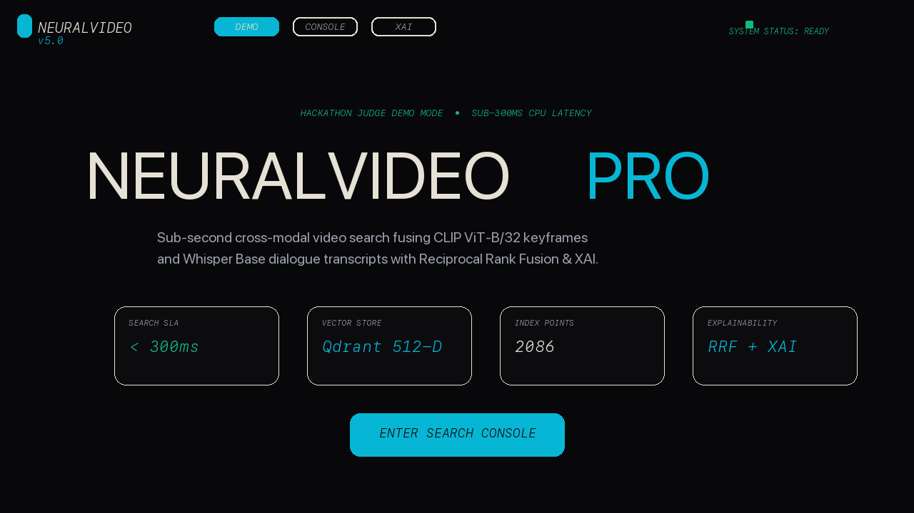

# VEA - Multimodal Video Search and Intelligence Engine

Real-Time Cross-Modal Deep Video Retrieval with OpenAI CLIP (512-D), OpenAI Whisper Speech Transcription, Reciprocal Rank Fusion (RRF), Cross-Modal Agreement Scoring, Maximal Marginal Relevance (MMR) Diversification, and Grounded Video-RAG with Groq (gpt-oss-20b).

---

## 1. Executive Summary

VEA (Video Exploration & Analytics) is a high-performance multimodal video search engine designed for semantic retrieval over unstructured video archives. The engine processes raw video streams into synchronized visual keyframe embeddings via OpenAI CLIP and speech transcript embeddings via OpenAI Whisper, storing and fusing them within an embedded Qdrant vector database using Auto-Intent Late Fusion.

### Core Architecture Highlights

- **Dual-Modality Vector Search:** 512-dimensional L2-normalized cosine similarity matching across visual keyframes and acoustic speech transcripts.
- **Auto-Intent Classification:** Dynamic query intent detection balancing visual bias (alpha = 0.8) vs. acoustic speech bias (alpha = 0.2) or balanced hybrid fusion (alpha = 0.5).
- **Reciprocal Rank Fusion (RRF):** Rank-based fusion algorithm (k = 60) overcoming scale disparities between visual and text modalities.
- **Dynamic Modality Masking:** Automatic detection and zero-weighting of silent frames or missing audio tracks to prevent noise corruption.
- **Maximal Marginal Relevance (MMR):** Semantic vector diversification using pairwise cosine similarity over 512-D visual vectors to eliminate redundant keyframe matches.
- **Per-Video Result Cap:** Limits each video to max 2 results per query to prevent single-video dominance.
- **Explainable AI (XAI) Attribution:** Full score breakdowns including primary modality driver, visual similarity percentage, audio similarity percentage, fused score percentage, confidence tiering, and human-readable match rationales.
- **Grounded Video-RAG:** Question-answering pipeline synthesizing grounded answers from retrieved visual scene descriptions and Whisper transcript segments with `[Source N]` citations via Groq (gpt-oss-20b).

---

## Demo



*Screen recording of the running app (Playwright-driven Chromium, no mock-ups or simulated frames): landing page → query typing in the search console → live pipeline storytelling bar → results page with retrieval timeline track, keyframe match reel, synchronized video player, and the XAI score grid.*

---

## 2. System Architecture & Workflow

```
+-----------------------------------------------------------------------------------+
|                                  USER QUERY                                       |
+-----------------------------------------------------------------------------------+
                                         |
                                         v
+-----------------------------------------------------------------------------------+
|                             Auto-Intent Classifier                                |
|        Classifies query intent -> Alpha Weight (Visual vs. Audio Bias)            |
+-----------------------------------------------------------------------------------+
                                         |
                                         v
+-----------------------+                             +-----------------------------+
|   Text Query Encoder  |                             |   CLIP Vision Encoder       |
| (clip-vit-base-patch32|                             | (clip-vit-base-patch32)     |
+-----------------------+                             +-----------------------------+
            |                                                        |
            +----------------------------+---------------------------+
                                         |
                                         v
+-----------------------------------------------------------------------------------+
|                           Qdrant Vector Database                                  |
|            Dual 512-D Named Vectors: visual_vector & audio_vector                 |
+-----------------------------------------------------------------------------------+
                                         |
                                         v
+-----------------------------------------------------------------------------------+
|                         Reciprocal Rank Fusion (RRF)                              |
|           RRF Score = w_v / (60 + Rank_v) + w_a / (60 + Rank_a)                   |
+-----------------------------------------------------------------------------------+
                                         |
                                         v
+-----------------------------------------------------------------------------------+
|               Maximal Marginal Relevance (MMR) Diversification                    |
|                Reranks candidates to ensure keyframe diversity                    |
+-----------------------------------------------------------------------------------+
                                         |
                                         v
+-----------------------------------------------------------------------------------+
|           Per-Video Cap (max 2 per video) + MMR Diversification                   |
|                Reranks candidates to ensure cross-video diversity                 |
+-----------------------------------------------------------------------------------+
                                         |
                                         v
+-----------------------------------------------------------------------------------+
|                        FastAPI Server & Next.js UI                                |
|        < 300 ms CPU Latency, XAI Score Breakdown, Synchronized Video Player      |
+-----------------------------------------------------------------------------------+
                                         |
                                         v
+-----------------------------------------------------------------------------------+
|                      Grounded Video-RAG (Groq gpt-oss-20b + Citations)           |
+-----------------------------------------------------------------------------------+
```

---

## 3. Directory Layout

```
VEA/
|-- backend/                      # FastAPI REST Application & ML Pipeline
|   |-- api.py                    # REST API Endpoints (/health, /search, /ask-video, /corpus/stats)
|   |-- schemas.py                # Pydantic Schemas & Telemetry Models
|   |-- legacy/                   # Streamlit Showcase App (Legacy UI)
|   |-- src/                      # Core Package
|   |   |-- db/                   # Qdrant Vector Store Wrapper
|   |   |-- ingestion/            # Keyframe Sampler & Audio Transcriber
|   |   |-- models/               # CLIP Vision & Text Encoder Modules
|   |   |-- rag/                  # Grounded Video-RAG Generator (Groq)
|   |   `-- retrieval/            # Ranker, XAI Attribution & Merging Logic
|   `-- tests/                    # Comprehensive Test Suite
|-- frontend/                     # Next.js 16 Web Application (TypeScript, Tailwind CSS)
|   |-- app/                      # Next.js App Router (page.tsx, layout.tsx, globals.css)
|   |   `-- api/                  # API Route Proxies (/api/search, /api/ask-video)
|   |-- components/               # UI Components (WireframeArcs.tsx, AskVideo.tsx, …)
|   `-- lib/                      # API Client Service (api.ts)
|-- data/                         # Datasets & Vector Database Storage
|   |-- raw/                      # Source MP4 Video Files
|   |-- processed/                # Extracted Keyframe JPEGs (extracted_frames_v2/)
|   `-- vectors/                  # Embedded Qdrant Database Storage
|-- docs/                         # Architecture Documentation & Specifications
|-- reports/                      # Evaluation Reports & IR Benchmark Results
|-- scripts/                      # Operational Scripts
|   |-- ingestion/                # Video Ingestion Scripts
|   |-- evaluation/               # Evaluation & Latency Benchmark Suites
|   `-- utilities/                # Pipeline Verification Tools
|-- requirements.txt              # Python Dependencies
`-- setup.sh                      # Environment Setup Script
```

---

## 4. Prerequisites

Ensure your host system meets the following requirements:

1. **Python 3.11** (Python 3.11 recommended for PyTorch wheel compatibility)
2. **Node.js 18+** and `npm`
3. **ffmpeg** binary (required for demuxing video/audio streams):
   - **macOS:** `brew install ffmpeg`
   - **Linux (Ubuntu/Debian):** `sudo apt update && sudo apt install -y ffmpeg`
   - **Windows:** Download from `ffmpeg.org` or install via `winget install ffmpeg`

---

## 5. Installation Guide

### Option 1: Manual Setup

1. **Clone the Repository:**
   ```bash
   git clone https://github.com/sriram615/NeuralVideoPro.git
   cd NeuralVideoPro
   ```

2. **Create Python Virtual Environment:**
   ```bash
   python3.11 -m venv .venv
   source .venv/bin/activate
   ```

3. **Install Python Dependencies:**
   ```bash
   pip install --upgrade pip
   pip install -r requirements.txt
   ```

4. **Install Frontend Dependencies:**
   ```bash
   cd frontend
   npm install
   cd ..
   ```

5. **Configure Environment Variables:**
   ```bash
   cp .env.example .env
   ```

### Option 2: Automated Setup Script

On macOS or Linux, run:
```bash
bash setup.sh
```

### Environment Variables

Copy `.env.example` to `.env` and configure:

| Variable | Description | Required |
|----------|-------------|----------|
| `QDRANT_DB_PATH` | Path to local Qdrant database directory | No (default: `./data/vectors/qdrant_db`) |
| `GROQ_API_KEY` | Groq API key for generative Video-RAG answers | Yes (for ask-video endpoint) |
| `GROQ_MODEL` | Groq model to use | No (default: `openai/gpt-oss-20b`) |
| `HOST` | FastAPI host | No (default: `0.0.0.0`) |
| `PORT` | FastAPI port | No (default: `8000`) |
| `NEXT_PUBLIC_API_URL` | Backend URL for frontend | No (default: `http://localhost:8000`) |

Get a Groq API key at https://console.groq.com/

---

## 6. Running the Application

### 1. Start the FastAPI Backend Server

```bash
# Activate virtual environment
source .venv/bin/activate

# Launch Uvicorn ASGI server from the backend directory
cd backend
PYTHONPATH=. ../.venv/bin/python -m uvicorn api:app --host 0.0.0.0 --port 8000
```

The backend server runs at `http://localhost:8000`. Interactive OpenAPI documentation is available at `http://localhost:8000/docs`.

### 2. Start the Next.js Frontend Development Server

Open a new terminal window:

```bash
cd frontend
npm run dev
```

The web application runs at `http://localhost:3000`.

---

## 7. API Reference

### GET /api/v1/health

Probes backend system readiness, loaded model status, Qdrant connectivity, and total vector count.

**Response Example:**
```json
{
  "status": "ok",
  "models_loaded": {
    "clip_encoder": true,
    "whisper_transcriber": true,
    "text_encoder": true
  },
  "qdrant_connected": true,
  "total_vectors": 15847,
  "collection_name": "video_intelligence"
}
```

---

### POST /api/v1/search

Executes Reciprocal Rank Fusion multimodal video search with auto-intent classification, MMR diversification, and XAI attribution.

**Request Payload:**
```json
{
  "query": "Steve Jobs discussing computers",
  "top_k": 5,
  "override_alpha": null,
  "domain_filter": "all",
  "enable_mmr": true,
  "enable_reranker": false
}
```

**Response Example:**
```json
{
  "status": "SUCCESS",
  "query": "Steve Jobs discussing computers",
  "total_results": 5,
  "latency_ms": 142.5,
  "intent": {
    "alpha": 0.5,
    "intent_label": "Balanced Hybrid",
    "visual_weight_pct": 50,
    "audio_weight_pct": 50,
    "auto_detected": true,
    "masked_modality": null
  },
  "results": [
    {
      "rank": 1,
      "id": "f4f5dd20-cf08-4ab3-983d-934f624550d3",
      "fused_score": 0.144415,
      "visual_score": 0.28883,
      "audio_score": 0.0,
      "rrf_score": 0.008668,
      "payload": {
        "video_id": "Steve Jobs Interview Feb 18 1981_936669ae85ba",
        "timestamp": 593.593,
        "frame_idx": 10,
        "transcribed_text": "Are there any other major areas that personal computers are going to change...",
        "domain": "news",
        "frame_path": "data/extracted_frames/Steve Jobs Interview Feb 18 1981_936669ae85ba/frame_000010.jpg",
        "file_name": "Steve Jobs Interview Feb 18 1981.mp4"
      },
      "xai": {
        "primary_driver": "CLIP Visual Scene",
        "primary_driver_emoji": "VISUAL",
        "visual_similarity_pct": 28.9,
        "audio_similarity_pct": 0.0,
        "fused_score_pct": 14.4,
        "rrf_score": 0.008668,
        "fusion_formula": "(0.50 x Visual) + (0.50 x Audio)",
        "confidence_tier": "HIGH"
      },
      "confidence_band": "HIGH"
    }
  ]
}
```

---

### POST /api/v1/ask-video

Executes Grounded Video-RAG Q&A deriving answers strictly from retrieved visual scene descriptions and Whisper dialogue transcripts, synthesized by Groq (gpt-oss-20b) with `[Source N]` citations.

**Request Payload:**
```json
{
  "question": "What did Steve Jobs say about personal computers?",
  "top_k_snippets": 5,
  "use_mmr": true
}
```

**Response Example:**
```json
{
  "question": "What did Steve Jobs say about personal computers?",
  "answer": "Steve Jobs said calculators would eliminate slide rules... [Source 1]",
  "citations": [
    {
      "video_id": "Steve Jobs Interview Feb 18 1981_936669ae85ba",
      "event_window": "13.0s - 15.0s",
      "hero_timestamp": 13.0,
      "transcript_snippet": "...",
      "visual_description": "Keyframe visual scene in window 13.0s–15.0s"
    }
  ],
  "context_snippets": ["..."],
  "retrieval_latency_ms": 142.5,
  "llm_latency_ms": 800.0,
  "latency_ms": 942.5
}
```

---

### GET /api/v1/corpus/stats

Returns vector collection metrics, vector dimensions, active domain tags, and video catalog details.

---

## 8. Video Ingestion Pipeline

To ingest new MP4 video files into the local Qdrant vector store:

1. **Place Source Video Files:**
   Add target `.mp4` files into `data/raw/raw_videos/`.

2. **Execute Ingestion Script:**
   ```bash
   source .venv/bin/activate
   python -m scripts.ingestion.ingest_and_test_steve_jobs
   ```

3. **Ingestion Steps Executed Automatically:**
   - Keyframe extraction at 1 frame per second via OpenCV.
   - Audio extraction to 16 kHz mono WAV via ffmpeg.
   - Speech transcription via OpenAI Whisper.
   - 512-D visual keyframe encoding via OpenAI CLIP (`openai/clip-vit-base-patch32`).
   - Transcript segment matching and text encoding via CLIP text encoder.
   - Upsert of dual-vector points into Qdrant collection `video_intelligence`.

---

## 9. Automated Testing & Benchmarking

### Running the Test Suite

Execute all 36 backend unit and integration tests:

```bash
source .venv/bin/activate
pytest -v
```

### Running Evaluation Suites

Execute Information Retrieval (IR) ablation metrics and latency benchmarks:

```bash
# Evaluation & Ablation Suite (Annotated Test Queries)
python -m scripts.evaluation.eval_suite

# Mode Latency SLA Benchmark
python -m scripts.evaluation.eval_benchmark

# Pipeline Verification Script
python -m scripts.utilities.verify_pipeline_test
```

Reports are saved to `reports/eval_results.md`.

### LLM-Generated Question Evaluation

42 easy/medium/hard questions were generated from video transcripts using Groq (gpt-oss-20b) and run through the retrieval pipeline:

| Difficulty | Correct | Total | Accuracy |
|------------|---------|-------|----------|
| Easy       | 13      | 14    | 92.9%    |
| Medium     | 13      | 14    | 92.9%    |
| Hard       | 14      | 14    | 100.0%   |
| **Overall**| **40**  | **42**| **95.2%**|

Generate new questions:

```bash
source .venv/bin/activate
PYTHONPATH=backend python scripts/evaluation/generate_llm_questions.py
```

Results saved to `reports/llm_generated_evaluation.md` and `backend/tests/data/llm_generated_questions.json`.

---

## 10. License

This project is released under the MIT License. See [LICENSE](LICENSE) for full details.
